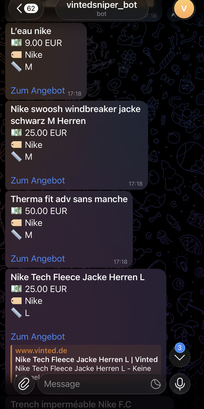

# Vinted Sniper

Watches [Vinted](https://www.vinted.de) for listings that match your brand,
size, price ceiling and keywords, and pings you (Telegram or terminal) with a
direct link as soon as one shows up.

It only reads public listings (the same ones any logged-out visitor sees). It
doesn't log in, buy, bid or touch your account.

## What it looks like

Each new match arrives in Telegram with the title, price, brand, size and a
direct link, plus the listing photo as a preview:



## How it works

Vinted sits behind Cloudflare and renders its search results server-side, so a
plain HTTP request just gets bot-blocked (`404`). So the sniper drives a headless
Chromium through Playwright. It loads the search page like any visitor, which
clears the Cloudflare check on its own, and reads the item cards out of the
rendered page.

1. A headless browser loads the search page for each watch, newest first.
2. It extracts the item cards (id, title, brand, size, price) from the DOM.
3. It remembers which listing ids it has already seen, so each item pings once.
4. It checks each new listing against your filters (price, size, brand, keywords).
5. It notifies you for the ones that pass.

The first pass fills the seen-set without notifying you, so you only hear about
items posted after you start watching.

```
+--------------+  rendered cards  +---------+  passes?  +----------+
| VintedClient | ---------------> | Filters | --------> | Notifier | --> phone
|  (Playwright)|                  +---------+           +----------+
+--------------+                                              
        ^                                                     
        +----------- Monitor polls every N seconds -----------+
                     (dedup by listing id)
```

## Installation

You need Python 3 and git. Then:

```bash
# 1. clone the project and go into the folder
git clone https://github.com/<you>/vinted-sniper.git
cd vinted-sniper

# 2. run it, the first start sets up everything automatically
#    (virtualenv, dependencies, and a headless Chromium for Playwright)
./run.sh "nike jacke" 50
```

The first run takes a minute or two because it downloads the browser. Later runs
start right away.

If you get a "permission denied" on `./run.sh`, make it executable once:

```bash
chmod +x run.sh
```

## Usage

```bash
./run.sh "nike jacke"              # just a search
./run.sh "nike jacke" 50           # + max price 50 EUR
./run.sh "nike jacke" 50 M L       # + max price + only sizes M / L
```

While it runs it prints matches to the terminal (or sends them to Telegram, see
below). Stop it with Ctrl+C.

## Example run

```console
$ ./run.sh "nike vintage" 70
17:13:43 INFO sniper: watching 1 search(es), every 60s
17:13:43 INFO vinted_sniper.monitor: Priming 1 filter(s)...
17:13:44 INFO vinted_sniper.monitor: Primed 'nike vintage' with 96 existing listings
17:13:44 INFO vinted_sniper.monitor: Watching. Polling every 60s. Ctrl+C to stop.
17:15:47 INFO vinted_sniper.monitor: HIT: Nike Rework Damen Sweater Vintage Y2K Unikat (32.50 EUR)
17:15:47 INFO vinted_sniper.monitor: HIT: Veste Nike Vintage Zippee Gris et Bleu Marine (49.00 EUR)
17:16:48 INFO vinted_sniper.monitor: HIT: Legging Nike running (10.00 EUR)
17:16:48 INFO vinted_sniper.monitor: HIT: Sweat a capuche Nike noir, triple logo Swoosh (20.00 EUR)
```

Each `HIT` is a freshly listed item that passed your filters. With Telegram set
up (see below) these go to your phone instead, with the listing photo attached.

## All options

Run a single search straight from the command line:

```bash
python main.py "SEARCH" [options]
```

| Option         | What it does                                 | Example                 |
|----------------|----------------------------------------------|-------------------------|
| `query`        | what to search for (first positional arg)    | `"nike jacke"`          |
| `--max-price`  | ignore anything pricier                      | `--max-price 50`        |
| `--min-price`  | ignore suspiciously cheap (1 EUR) listings   | `--min-price 10`        |
| `--sizes`      | only these sizes (one or more)               | `--sizes M L XL`        |
| `--brands`     | only these brands                            | `--brands Nike Adidas`  |
| `--keywords`   | title must contain all of these              | `--keywords vintage`    |
| `--poll`       | seconds between checks (min 30, default 60)  | `--poll 45`             |
| `--base-url`   | another country's Vinted                     | `--base-url https://www.vinted.fr` |
| `--config`     | yaml file with several searches at once      | `--config config.yaml`  |

Examples:

```bash
# Nike jacket, max 50 EUR, only M or L
python main.py "nike jacke" --max-price 50 --sizes M L

# vintage Carhartt only, title must contain "vintage"
python main.py "carhartt" --brands Carhartt --keywords vintage --max-price 80
```

`./run.sh` is a shortcut for the common case: `./run.sh "QUERY" [max_price] [size...]`.
For brands/keywords, call `main.py` with its flags, or use a config file.

## Telegram notifications (optional)

Without this, hits just print to the terminal. To get them on your phone:

1. In Telegram, message [@BotFather](https://t.me/BotFather), send `/newbot`,
   follow the steps, and copy the bot token it gives you.
2. Open a chat with your new bot and send it any message (e.g. "hi").
3. Run the setup helper, which finds your chat id automatically, sends a test
   message and writes everything to `.env`:

```bash
./.venv/bin/python setup_telegram.py
```

## Watching several searches at once

```bash
cp config.example.yaml config.yaml   # edit it: brands, keywords, multiple filters
./run.sh --config config.yaml
```

## Project layout

```
vinted_sniper/
  vinted_client.py   # drives headless Chromium, parses the item cards
  filters.py         # SearchFilter: one watch, decides what matches
  notifier.py        # Telegram (or stdout fallback)
  monitor.py         # poll loop, dedup, priming, browser cleanup
main.py              # CLI + config wiring
tests/               # pytest suite: filters, dedup, and card parsing
```

## Tests

```bash
./.venv/bin/python -m pytest
```

19 tests covering the filter rules, the monitor's dedup/priming, and the
price/title parsing. They all run offline, without touching Vinted or a browser.

## Notes and limitations

- The scraper depends on Vinted's page markup. If that changes, check the
  selectors in `vinted_client.py` first.
- A real browser is heavier than an HTTP call. Keep `--poll` at 30s or more.
- Personal/educational project. Stick to Vinted's Terms of Service.

## License

MIT, see [LICENSE](LICENSE).
